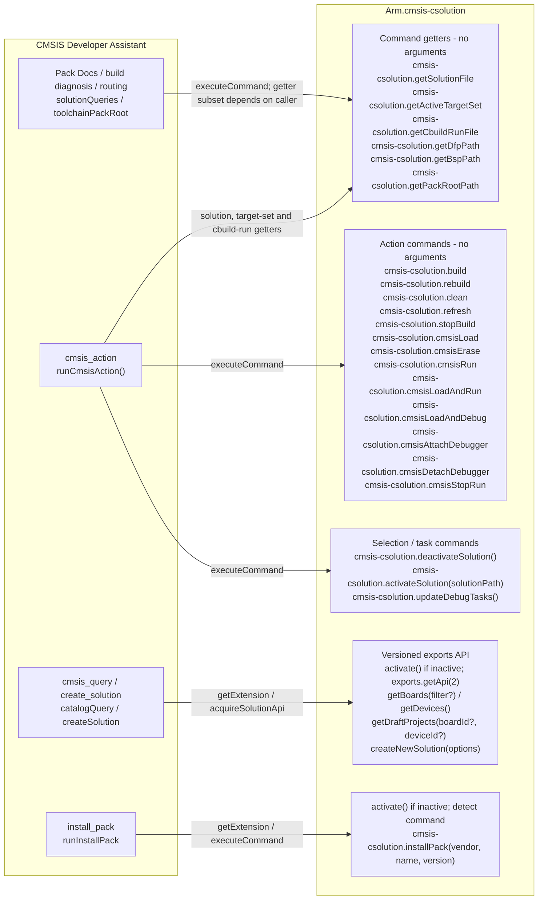
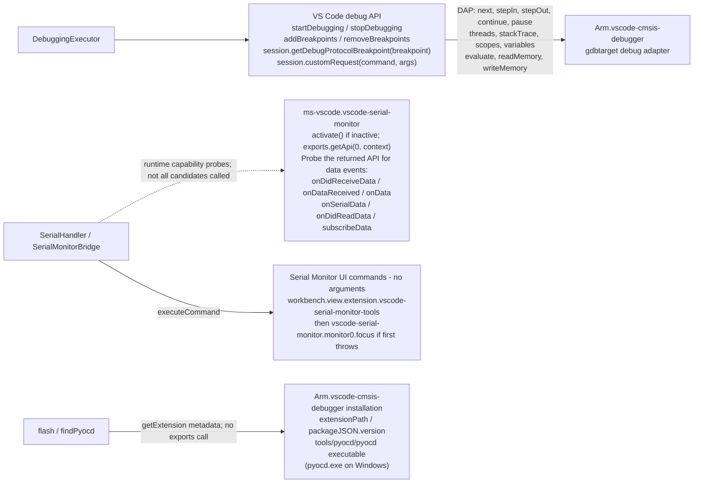

# Cross-extension calls

Internal call inventory, checked against the 2.7.0 implementation at
commit `8ec3ba3` (2026-10-27). The diagrams show
outbound boundaries, not a proposed API or every internal function call.
The tables give exact command IDs, arguments and fallback behavior. For the
separate storage-management proposal, see
[Pack Docs: external document-storage management](pack-docs-storage.md).

`package.json` has empty `extensionDependencies` and `extensionPack` arrays.
These integrations are discovered at runtime: a feature may refuse when its
provider is absent, but the extension itself has no manifest-level hard
dependency on these extensions.

## CMSIS Solution

The getter box is the union of several call sites, not a six-command query
sent on every operation. `create_solution` uses the exports API; ordinary
build/load/run actions use commands. The implementation of target switching
writes `.vscode/cmsis.json` and reactivates the solution; there is no call to
a public target-set setter.

### Action commands

Every CMSIS Solution action in this table uses
`vscode.commands.executeCommand(commandId)` with **no arguments**, even when
the MCP action has target, timeout or waiting options. The owning
window/active solution supplies the context. `activate_environment` calls a
different extension with a manifest URI; see the Environment Manager section.

Source: [`cmsisAction.ts`](../../src/handler/cmsisAction.ts),
`ACTION_COMMANDS` and `issueCommand()`.

| `cmsis_action` action | Exact command ID |
| --- | --- |
| `build` | `cmsis-csolution.build` |
| `rebuild` | `cmsis-csolution.rebuild` |
| `clean` | `cmsis-csolution.clean` |
| `refresh` | `cmsis-csolution.refresh` |
| `stop_build` | `cmsis-csolution.stopBuild` |
| `load` | `cmsis-csolution.cmsisLoad` |
| `erase` | `cmsis-csolution.cmsisErase` |
| `run` | `cmsis-csolution.cmsisRun` |
| `load_and_run` | `cmsis-csolution.cmsisLoadAndRun` |
| `load_and_debug` | `cmsis-csolution.cmsisLoadAndDebug` |
| `attach` | `cmsis-csolution.cmsisAttachDebugger` |
| `detach` | `cmsis-csolution.cmsisDetachDebugger` |
| `stop_run` | `cmsis-csolution.cmsisStopRun` |

### Context and setup commands

The context and setup commands below supplement the action commands.
Parentheses show the arguments passed to `executeCommand`, not a direct
method on an exports object.

| Exact call | Caller / purpose |
| --- | --- |
| `cmsis-csolution.getSolutionFile()` | `cmsisAction.activeSolution()`; `packDocsHost.activeContext()`; build diagnosis; `windowCoordinator.querySolutionFile()`. |
| `cmsis-csolution.getActiveTargetSet()` | `cmsisAction.activeTargetName()`; `packDocsHost.activeContext()`; build diagnosis. |
| `cmsis-csolution.getCbuildRunFile()` | `cmsisAction.activeCbuildRunFile()`; `solutionQueries.activeCbuildRunFile()` for Pack Docs and flash-related target resolution. |
| `cmsis-csolution.getDfpPath()` | `solutionQueries.activePackFolders()`; locate the active device pack, including packs outside the default root. |
| `cmsis-csolution.getBspPath()` | `solutionQueries.activePackFolders()`; locate the active board pack. |
| `cmsis-csolution.getPackRootPath()` | `toolchainPackRoot()`; shared pack-root lookup for documentation, SVDs, installation and build diagnosis. |
| `cmsis-csolution.deactivateSolution()` | `cmsisAction.switchActiveTarget()`, before reactivation. |
| `cmsis-csolution.activateSolution(solutionPath)` | `switchActiveTarget()` and `open_solution` / `activateHere()`; one string naming the csolution file, not a target name or folder. |
| `cmsis-csolution.updateDebugTasks()` | `writeCmsisTasks()` when required tasks are missing, `cmsis-csolution.autoDebugLaunch` is enabled and the active cbuild-run names a debugger. |
| `cmsis-csolution.installPack(vendor, name, version)` | `runInstallPack()` via `VSCODE_PACK_INSTALL_HOST`; three strings, following the licence/confirmation gate, then installation verification. |

The getter paths deliberately have different availability behavior:

- [`solutionQueries.askSolution()`](../../src/utils/solutionQueries.ts)
  checks `Arm.cmsis-csolution.isActive`, checks `getCommands(true)`, and
  allows three seconds including command lookup. It does not activate an
  inactive extension. Missing/failed/slow answers become `undefined` and
  retain the caller's filesystem fallback. Its `getCbuildRunFile`,
  `getDfpPath` and `getBspPath` commands are hidden, non-public interfaces.
- [`packDocsHost.activeContext()`](../../src/packDocsHost.ts) calls
  `getSolutionFile` and `getActiveTargetSet` directly in parallel, with
  three seconds each; a rejection yields no context hint. It does not use
  the active-state/command-presence guard above.
- [`toolchainPackRoot()`](../../src/utils/toolchainPackRoot.ts) calls
  `getPackRootPath` directly with three seconds, caches a successful answer
  and retries a no-answer after 60 seconds. The fallback is `CMSIS_PACK_ROOT`
  or the platform default; extension/configuration changes invalidate its
  cache.
- The action service's solution/target getters use five-second fences.
  [`cmsisBuildDiagnosis`](../../src/cmsisBuildDiagnosis.ts) uses its own
  five-second `askFor()` path. The routing window's solution-file query
  only runs when CMSIS Solution is active.
- [`runInstallPack()`](../../src/handler/installPack.ts) can activate the
  extension and feature-detects `installPack`. Its availability and licence
  gates are defined in [`packInstall.ts`](../../src/core/packInstall.ts).

### Versioned exports API

The catalogue and solution-creation path starts at
[`host.solutionExtension()`](../../src/handler/host.ts), which calls
`vscode.extensions.getExtension('Arm.cmsis-csolution')`.
[`acquireSolutionApi()`](../../src/core/solutionApi.ts) activates it only
when inactive (20-second activation budget), calls `exports.getApi(2)`,
checks all four required methods and caches the API per exports object.
Missing extension, failed activation or unavailable API version/methods are
explicit refusals, not a switch to an unversioned API.

| API call | Arguments actually supplied / consumed result |
| --- | --- |
| `getBoards(filter)` | Board listing passes `undefined`, or `{ mountedDevice: {} }` when a device filter is requested. Board-ID resolution for examples/creation calls `getBoards()` without arguments. Vendor/name matching is local. |
| `getDevices()` | No arguments; matching is local. |
| `getDraftProjects(board?.id, device?.id)` | Two possibly undefined API ID objects, not the user's input strings. |
| `createNewSolution({ draft, board, device, folder, git })` | Resolved API objects, destination folder string, and `git: request.git === true`; returns a promise-like completion. |

Sources: [`catalogQuery.ts`](../../src/core/catalogQuery.ts) and
[`createSolution.ts`](../../src/handler/createSolution.ts).
The catalogue also awaits board `.devices` / `.pack` and device `.pack` /
`.processors`. `catalogErrorsOf()` best-effort reads `api.dataManager.errors`;
that field is **not part of the published API** and cannot be required for
success. API v2 is documented in the source as available since CMSIS
Solution 1.46.0; the consumed shape was checked against 1.72.0.

`cmsis_query` currently exposes `boards`, `devices`, `examples`. The
`context`/`toolchain` query shapes in proposal #41 are not implemented calls.
Creation delegates its subsequent environment-management and folder-opening
work to CMSIS Solution. The separate `activate_environment` action calls
Environment Manager directly, as described below.

### Task observation is a VS Code boundary

[`registerCmsisJobTracker()`](../../src/cmsisJobTracker.ts) observes
`vscode.tasks.onDidStartTask`, `onDidStartTaskProcess`, `onDidEndTaskProcess`
and `onDidEndTask`; it reads `taskExecutions` and uses `fetchTasks()` for a
bounded label lookup. The action service calls `TaskExecution.terminate()`
for surviving matching work after a stop command. There is no direct
`tasks.executeTask()` call.

[`cmsisTasks.ts`](../../src/core/cmsisTasks.ts) recognizes task type
`cmsis-csolution.build` (including setup/clean/rebuild variants), the labels
`CMSIS Load`, `CMSIS Run`, `CMSIS Load+Run`, `CMSIS Erase`, `CMSIS TargetInfo`,
and the `arm-debugger.flash` / `CMSIS Load+Run` case. It also recognizes
`Target Information` with source `CMSIS`. These are task classification
keys, not extension-export methods. Task events establish completion; the
command's returned promise alone does not establish a successful build or
flash.

## Arm Tools Environment Manager

`cmsis_action activate_environment` calls
`vscode.commands.executeCommand('environment-manager.reactivate', manifestUri)`,
where `manifestUri` is `vscode.Uri.file()` of the `vcpkg-configuration.json`
found from the solution folder up to the workspace root. It checks the
registered commands first; a missing command names `Arm.environment-manager`
and asks the user to install or activate it. A missing manifest is refused.
There is no exports API call.

The command re-resolves the environment and can download tools or wait for
user licence/activation prompts. Completion is observed through
`.cmsis/tools-environment.yml`: its modification time must change and stay
unchanged for a second poll. The result then lists the recorded tools. If
that takes longer than the call's wait, the result is `running` and explains
how to retry activation after checking any prompts. This is separate from
the CMSIS task tracker.

Source: [`activateEnvironment()`](../../src/handler/cmsisAction.ts).

## Debugger and Serial Monitor

Solid lines show explicit calls or VS Code-mediated traffic. The dotted
line probes optional data events on the versioned API: its names describe
methods this code tries, not guarantees that the installed extension provides them.
For other debug types, VS Code routes the same generic debug APIs to their
own adapters, not to CMSIS Debugger.

### Debug API and DAP

[`DebuggingExecutor`](../../src/debuggingExecutor.ts) calls
`vscode.debug.startDebugging(folder, configurationOrName)` and
`stopDebugging(session)`. A `gdbtarget` restart stops the root session,
waits for termination and starts its saved configuration. Source
breakpoints use `vscode.debug.addBreakpoints`, `vscode.debug.removeBreakpoints`
and `session.getDebugProtocolBreakpoint(breakpoint)`; VS Code sends
`setBreakpoints`, not an executor `customRequest('setBreakpoints', ...)`.

All directly sent DAP requests go through
[`customRequestWithTimeout()`](../../src/utils/timeout.ts) to
`session.customRequest(command, args)`:

| DAP request | Argument object |
| --- | --- |
| `next`, `stepIn`, `stepOut`, `continue`, `pause` | `{ threadId: focusedThreadId() }` |
| `threads` | `{}` |
| `stackTrace` | `{ threadId, startFrame: 0, levels }` |
| `scopes` | `{ frameId }` |
| `variables` | `{ variablesReference }` |
| `evaluate` | `{ expression, context: 'repl' or 'watch', frameId? }` |
| `readMemory` | `{ memoryReference, count }` |
| `writeMemory` | `{ memoryReference, data }`, with base64-encoded `data` |

Supporting call sites are in
[`snapshot.ts`](../../src/executor/snapshot.ts),
[`sessionReports.ts`](../../src/executor/sessionReports.ts),
[`gdbMemory.ts`](../../src/executor/gdbMemory.ts),
[`gdbCommand.ts`](../../src/executor/gdbCommand.ts) and
[`peripheralReader.ts`](../../src/core/peripheralReader.ts).
GDB/MI commands, including reset and memory fallbacks, travel as REPL
`evaluate` expressions: `'>' + command` on `gdbtarget`, `'-exec ' + command`
elsewhere. They are not calls to CMSIS Debugger's JavaScript exports.

The session tracker registers
`vscode.debug.registerDebugAdapterTrackerFactory('*', factory)` and
observes requests/responses and `stopped`, `continued`, `output`,
`breakpoint`, `terminated`, `exited` events. It also observes VS Code's
session lifecycle; see
[`sessionStateTracker.ts`](../../src/utils/sessionStateTracker.ts).

Only non-`gdbtarget` adapters have the non-timeout run-control fallback
commands `workbench.action.debug.stepOver`, `.stepInto`, `.stepOut`,
`.continue`, `.pause`; their restart uses `workbench.action.debug.restart`.
These are VS Code workbench commands, not commands owned by CMSIS Debugger.

### Reusing the debugger's bundled executable

[`findPyocd()`](../../src/handler/flashTool.ts) reads
`getExtension('Arm.vscode-cmsis-debugger')` through the host, using
`extensionPath` and `packageJSON.version` to locate its bundled executable.
It does not call `activate()` or an exports API. The implementation in
[`flashController.ts`](../../src/core/flashController.ts) prefers
`<extensionPath>/tools/pyocd/pyocd` (`pyocd.exe` on Windows), then the
solution's `.cmsis/tools-environment.yml`, then PATH. It probes candidates
with `['--version']`, selects the first successful one, and programs with
`['load', '--no-wait', '--cbuild-run', cbuildRunFile]`.

This describes subprocesses run by the extension's `flash` implementation,
not shell instructions for an agent. Board operations remain behind the
CMSIS MCP tools.

### Peripheral Inspector: not called

Since commit `17d9111` (in 2.7.0), `read_peripheral_register` does not look
up `eclipse-cdt.peripheral-inspector`. `DebuggingExecutor.readPeripheralRegister()`
checks the session first and reads the register at the address the device
SVD gives, through DAP `readMemory` or GDB
([`peripheralReader.ts`](../../src/core/peripheralReader.ts)). The earlier
probe of `getPeripherals()`, `getRegisterValue()` and `getRegisters()` is
gone: Peripheral Inspector 1.10.0 and upstream `main` have none of them (the
API registers SVD files and parsers, returns interrupt tables and reloads the
view for a session), so the probe always fell through to the SVD path. Two
cases in `test/transport/executor-cases.js` install a 1.10.0-shaped
extension and check that it is neither asked nor activated.

### Serial Monitor exports and UI commands

[`SerialMonitorBridge`](../../src/core/serialMonitorBridge.ts) lazily gets
`ms-vscode.vscode-serial-monitor`, activates it if necessary, calls
`exports.getApi(0, context)` with this extension's context, and caches the
returned API. Missing exports, a refused API version or a missing context
produce an unavailable result. The bridge probes that API, not the raw
exports, for these data-subscription capabilities:

| Purpose | Candidates and arguments |
| --- | --- |
| Data subscription | `onDidReceiveData(callback)`, `onDataReceived(callback)`, `onData(callback)`, `onSerialData(callback)`, `onDidReadData(callback)`, `subscribeData(callback)`; select the first function-shaped candidate. |
| Unsubscribe | Call `.dispose()` on a returned subscription disposable. |

API version 0 has none of these data events, so subscription is reported as
unavailable. There is no port-enumeration probe or port-change subscription. This bridge neither opens nor writes nor closes a
monitor-owned serial port. Direct serial I/O uses this extension's
`serialport` dependency, not a Serial Monitor exports method.

[`SerialHandler.handleOpenInUi()`](../../src/serialHandler.ts) tries
`executeCommand('workbench.view.extension.vscode-serial-monitor-tools')`,
then `executeCommand('vscode-serial-monitor.monitor0.focus')` only if the
first throws. Both have no arguments. The MCP tool name registered by this
source is `serial_open_monitor`.

## Host integration and non-calls

- [`extension.ts`](../../src/extension.ts) registers
  `vscode.lm.registerMcpServerDefinitionProvider('cmsis-developer-assistant', provider)`.
  It publishes `new vscode.McpHttpServerDefinition(PRODUCT, Uri.parse(endpoint + '/mcp'), undefined, SERVER_VERSION)`.
  This is VS Code's MCP discovery API, not a call to Copilot exports.
- [`AgentConfigurationManager`](../../src/utils/agentConfigurationManager.ts)
  manages configuration/skill/rule files and uses the built-ins
  `vscode.open` / `vscode.diff`. It reads `chat.useAgentsMdFile`; this is a
  host setting, not a remote agent-extension API.
- Other foreign settings read are `cmsis-csolution.autoDebugLaunch` for
  task generation and `cmsis-csolution.outputDirectory` for build diagnosis.
- `eclipse-cdt.peripheral-inspector` is neither looked up nor activated;
  see above.
- `arm.cmsis-pack-docs` is checked for presence to warn about duplicate
  tools. Its API is never called: Pack Docs is implemented in this
  repository, not delegated to that standalone extension.
- `Arm.keil-studio-pack` and `cmsis-csolution.manageSolution` occur in
  guidance, not as executed calls. Environment Manager is called by
  `activate_environment` as described above. `solutionFiles.ts` is a local
  file search, not an extension API.
- Commands beginning `cmsis-developer-assistant.` are our own handlers.
  Window forwarding is between instances of this extension, not another
  extension's public interface.

## Keeping the inventory current

When changing a boundary, check command dispatch in `cmsisAction.ts`,
`solutionQueries.ts`, `toolchainPackRoot.ts`, `packDocsHost.ts`,
`cmsisBuildDiagnosis.ts` and `installPack.ts`; exports in `solutionApi.ts`
and `serialMonitorBridge.ts`; and DAP in the executor and its supporting
modules. Keep proposed APIs out of the current-call
inventory. Validate and preview the Mermaid blocks after editing them.
